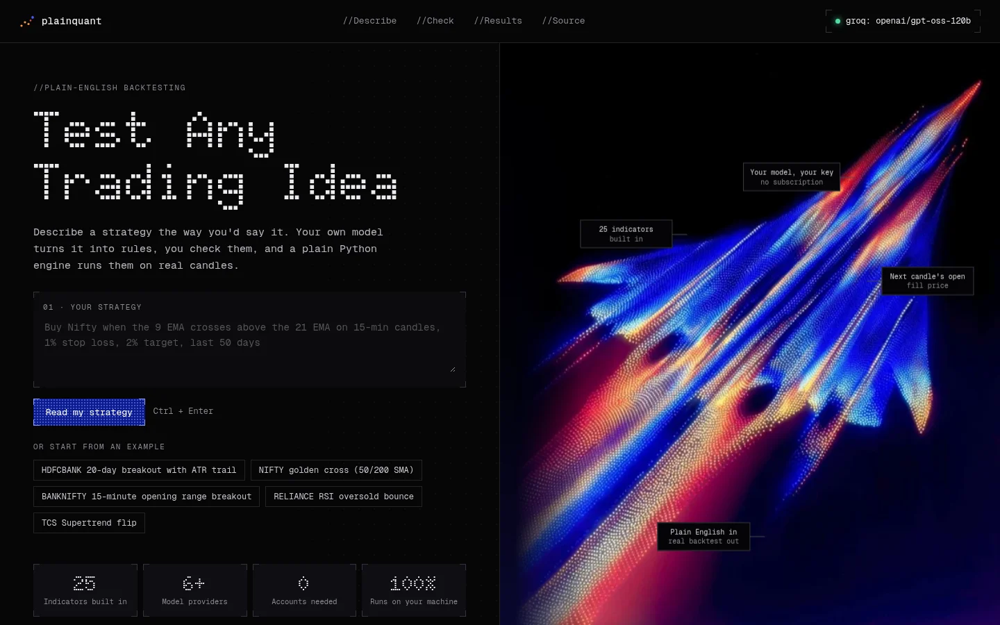
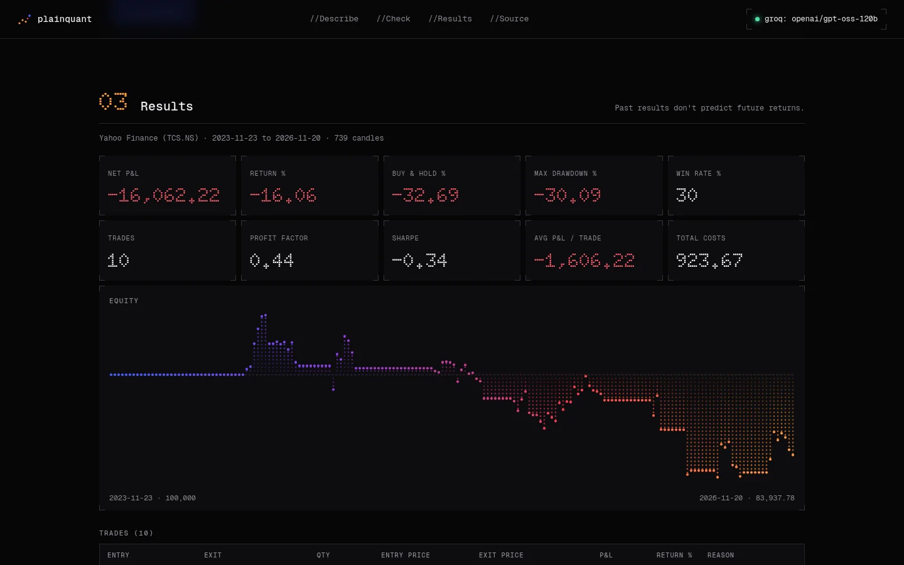

# plainquant

Describe a trading strategy in plain English and backtest it on real market data.

There are two reasons to use it:

- **You can change everything.** The strategy format, indicators, simulation engine and data
  sources are plain Python in this repo. Add the indicator you're missing, change how fills
  work, or plug in your broker's candles.
- **You bring your own model.** It works with Claude or any OpenAI-compatible endpoint, such as
  Ollama, LM Studio, OpenRouter or Groq. There's no account and no subscription.



It also runs entirely on your machine with no tracking. Your strategies and prompts go only to
the model endpoint you pick.

**What it's good for today:** stocks and indices. With the free data source (Yahoo Finance),
daily candles are solid and go back years. Intraday history is short: about 60 days of 5-minute
candles. There are no options chains, so options strategies aren't supported. Bring your own
CSV for longer intraday tests.

```
$ plainquant run "Buy RELIANCE when RSI(14) crosses above 30, sell when RSI goes above 70, 5% stop loss, last 5 years"

Here is how I read your strategy:

  - Instrument: RELIANCE (india), daily candles, positional
  - Entry: Buy at the next bar's open when RSI(14) crosses above 30
  - Exit: at the next bar's open when RSI(14) is above 70
  - Stop loss: 5% from entry
  - Size: 100% of current capital per trade
  - Period: last 1825 days

Run the backtest? [Y/n]
```

You get net P&L, return, CAGR, max drawdown, Sharpe, win rate, profit factor, every trade and
an equity curve, in the terminal, as JSON, as a shareable HTML file or in a local web app.



## How it works

1. **Describe it.** Your model turns the sentence into a small JSON strategy. The format is strict
   and validated, so the model can't invent indicators or settings. If it gets the format wrong, it
   gets one more try with the error message.
2. **Check the rules.** plainquant reads the JSON back to you in plain English and lists every
   setting the model filled in for you (candle size, period, sizing, costs). You can edit the JSON
   before running.
3. **Backtest it.** A plain Python engine runs the rules on the candles. The model is not involved
   in this step, so results are repeatable.

If a strategy can't be tested faithfully (option legs, pairs, fundamentals, mixed timeframes),
the model says so and suggests a version that can be tested, instead of quietly testing
something else.

## Install

```bash
pip install "plainquant[all] @ git+https://github.com/Nikshay1/plainquant"
```

Python 3.10 or newer. `[all]` adds the Claude and OpenAI-compatible clients and the web app.

## Bring your own model

Pick whichever you have. Your prompt goes only to the endpoint you configure.

| Model | Setup |
|---|---|
| Claude | `export ANTHROPIC_API_KEY=...` (defaults to `claude-opus-5-5`, override with `PLAINQUANT_MODEL`) |
| OpenAI | `export OPENAI_API_KEY=... PLAINQUANT_MODEL=<model>` |
| Ollama (free, fully local) | `export PLAINQUANT_PROVIDER=ollama PLAINQUANT_MODEL=<model>` |
| LM Studio (free, fully local) | `export PLAINQUANT_PROVIDER=lmstudio PLAINQUANT_MODEL=<model>` |
| OpenRouter | `export PLAINQUANT_PROVIDER=openrouter OPENROUTER_API_KEY=... PLAINQUANT_MODEL=<model>` |
| Groq | `export PLAINQUANT_PROVIDER=groq GROQ_API_KEY=... PLAINQUANT_MODEL=<model>` |
| Any OpenAI-compatible server (vLLM, llama.cpp, ...) | `export PLAINQUANT_PROVIDER=openai PLAINQUANT_BASE_URL=<url> PLAINQUANT_MODEL=<model>` (and `PLAINQUANT_API_KEY` if it needs one) |

Tested on Groq with `openai/gpt-oss-120b`: 16 of 16 test prompts were read correctly or declined
for the right reason. That set covers simple, intraday, short, ATR, opening-range, timed and
Hinglish prompts, plus options, pairs, fundamentals, mixed timeframes and nested logic. Smaller
models (`gpt-oss-20b`, `qwen3.8-27b`) get the overall decision right but sometimes misread
details, such as candle size, or add a rule nobody asked for. That's why plainquant always
shows you the rules before running. On Groq's free tier, expect about 30 seconds per prompt
because of its per-minute token limit.

Every command also takes `--provider`, `--model` and `--base-url`. A provider's own key (such as `OPENAI_API_KEY`)
is only ever sent to that provider; a custom endpoint gets `PLAINQUANT_API_KEY` or nothing. Small local models work
because the strategy format is flat and the reply is validated, but larger models read
complicated strategies more reliably.

No model at all? Write or edit a strategy file and run `plainquant backtest strategy.json`.

## Usage

```bash
plainquant run "Nifty 9 EMA crosses above 21 EMA on 15-min candles, 1% stop, 2% target, last 50 days"
plainquant run "..." --yes --html report.html     # skip the confirm step, save a report
plainquant parse "..." -o my_strategy.json         # just write the strategy file
plainquant backtest my_strategy.json               # run a file, no model needed
plainquant backtest --example golden_cross_nifty   # bundled examples: plainquant examples
plainquant serve                                   # web app on http://127.0.0.1:8000
plainquant indicators                              # what the engine understands
plainquant schema                                  # the strategy JSON Schema
```

## The strategy format

```json
{
  "name": "NIFTY 9/21 EMA crossover",
  "symbol": "NIFTY",
  "interval": "15m",
  "style": "intraday",
  "period": {"lookback_days": 50},
  "entry": {
    "match": "all",
    "rules": [
      {"type": "compare",
       "left":  {"kind": "indicator", "name": "ema", "period": 9},
       "op": "crosses_above",
       "right": {"kind": "indicator", "name": "ema", "period": 21}}
    ]
  },
  "risk": {"stop_loss": {"unit": "percent", "value": 1},
           "take_profit": {"unit": "percent", "value": 2}},
  "costs": {"slippage_pct": 0.05, "brokerage_per_order": 20}
}
```

- **Rules:** `compare` (`>`, `<`, `>=`, `<=`, `crosses_above`, `crosses_below`), `time_window` and
  `weekday`. A rule set matches `all` or `any` of its rules.
- **Operands:** a price field, an indicator, or a number. Any operand can look back with `bars_ago`.
- **Indicators:** SMA, EMA, WMA, VWAP, RSI, MACD, stochastic, ROC, CCI, Williams %R, ADX, OBV,
  ATR, Bollinger bands, Supertrend, highest/lowest (breakouts), opening range, previous day
  high/low/close, gap %. Run `plainquant indicators` for parameters.
- **Risk:** stop loss, take profit and trailing stop in percent, points, ATR multiples, or (for
  targets) multiples of the stop distance.
- **Sizing and costs:** fixed quantity or % of capital; slippage, brokerage per order and
  charges as % of turnover.

The full schema is in [`dsl.py`](src/plainquant/dsl.py) and `plainquant schema`.

## How trades are simulated

- Rules are checked on each candle's close and orders fill at the **next candle's open**, so a
  strategy can't trade on information it didn't have yet.
- Stops and targets are checked inside each candle using its high and low. If one candle touches
  both, the stop is assumed to hit first. If the price gaps past a level, the fill is at the open.
- Intraday strategies take no new entries after `last_entry` (15:00 IST by default), square off
  at `square_off` (15:15), and never hold overnight.
- One position at a time, long or short. Sizing by % of capital leaves room for entry fees.
- Results come with a list of every assumption the engine made, such as default costs or a
  shortened period.

## Market data

The default source is Yahoo Finance. It's free and needs no key, and it covers NSE and BSE
stocks, Indian indices (`NIFTY`, `BANKNIFTY`, `FINNIFTY`, `SENSEX`), US stocks and more. Yahoo
only keeps a short intraday history: 7 days of 1-minute candles, about 60 days of 5 to 30-minute
candles and 2 years of hourly candles. Daily candles go back decades. When a test asks for more,
plainquant shortens the period and tells you. Prices are the traded prices adjusted for splits but
not for dividends, so price levels match what you see on a chart. A candle that is still forming
is left out.

For longer intraday history, export candles from your broker and pass them in:

```bash
plainquant backtest my_strategy.json --csv nifty_5min.csv --csv-tz Asia/Kolkata
```

The CSV needs `timestamp` (or `date`), `open`, `high`, `low`, `close` and `volume` columns. Any
object with a `load()` method can be a data source (see [`data.py`](src/plainquant/data.py)), so
broker APIs can be plugged in the same way.

## Use it from Python

```python
from plainquant.dsl import Strategy
from plainquant.data import YahooProvider
from plainquant.engine import run
from plainquant.llm import parse_strategy

parsed = parse_strategy("Buy TCS when Supertrend turns up, sell when it turns down, last 3 years")
result = run(parsed.strategy, YahooProvider())
print(result.metrics["net_return_pct"], len(result.trades))
```

## What it doesn't do yet

- Options and futures strategies (strikes, premiums, multi-leg structures). These need
  historical option chain data, which isn't free.
- Several instruments in one strategy (pairs, baskets, screeners).
- Rules on two candle sizes at once.
- Nested logic such as `(A and B) or C`.

Contributions are welcome, see [CONTRIBUTING.md](CONTRIBUTING.md).

## Disclaimer

plainquant is a research tool. Backtests use past data and simple fill assumptions, and they
don't predict future returns. Nothing here is investment advice.

## License

MIT
